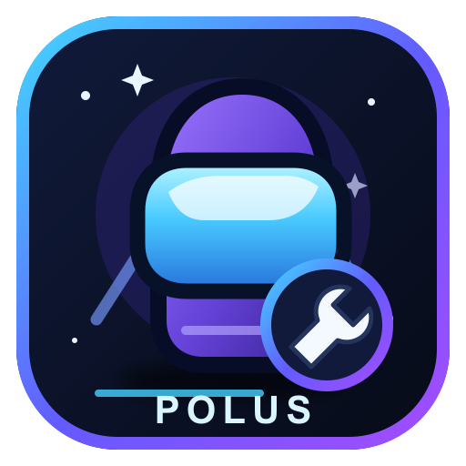

# Polus

  

**A custom-role mod and patcher project for Among Us.**

🌐 **Website:** [Polus Community](https://tvmanisback.github.io/Polus/)

---

## Downloads

| Platform | Status | Download |
| --- | --- | --- |
| **PC (Windows x64)** | Available | [**Download Polus.exe**](https://github.com/Tvmanisback/Polus/releases/download/1.1.0/Polus.exe) |
| **Android** | APK release | [**Download Polus APK**](https://github.com/Tvmanisback/Polus/releases/download/1.1.0/com.tvmanisback.poluscompanion.apk) |
| **iOS** | Unsupported | Not available |

**Windows:** Download and run `Polus.exe` directly; no ZIP extraction is required. **Android:** Download and install the APK, then open the Polus patcher. Android may require you to approve installation from your browser or file manager.

## Quick navigation

- [Downloads](#downloads)
- [Features](#features)
- [Compatibility](#compatibility)
- [Installation](#installation)
- [Disclaimer and credits](#disclaimer-and-credits)

## Features

### Windows patcher

- Detects Steam libraries, including secondary library folders.
- Checks that the installed Among Us executable is 64-bit.
- Installs the matching BepInEx IL2CPP x64 loader.
- Backs up files before replacing them.
- Installs the Polus plugin, role runtime, and role catalogue.
- Checks for updates and can update the patcher.
- Provides a restore option to undo the patcher's game-folder changes.

### Custom roles

- Includes 35 original role specifications.
- Role-specific ability labels and mechanics are implemented in the plugin.
- Uses a separate role ability button; the game's normal Kill button is not replaced.
- Quartermaster retains its separate emergency-meeting button.
- Custom role behavior requires compatible modded clients.

### Host panel

- Host-only panel opened with **P**.
- Player moderation controls.
- Private-lobby-only gameplay settings.
- Settings changes are restricted to the host and private lobbies.

## Compatibility

- **Game:** Among Us Steam, build 2026.9.29 / Build ID 25134893.
- **Architecture:** Windows x64 for the PC patcher; Android APK for the Android patcher.
- **Loader:** BepInEx 6 IL2CPP, build line 6.0.0-be.788.
- **Plugin target:** AmongUs.GameLibs.Steam 2026.9.29, Reactor 2.5.1-ci.400.

Game updates can break compatibility. All players who need custom role functionality must use a compatible Polus build. Vanilla mobile clients cannot run the custom plugin or custom role effects.

## Installation

### Windows
1. Download [**Polus.exe (version 1.1.0)**](https://github.com/Tvmanisback/Polus/releases/download/1.1.0/Polus.exe).
2. Run the EXE directly; no ZIP extraction is required.
3. Select **Setup**. The patcher searches Steam libraries automatically; use Browse if needed.
4. Let Setup install BepInEx and create a backup.
5. Select **Patch** to install Polus, then launch Among Us through Steam.
6. To undo the changes, use **Restore** with the backup created during Setup.

### Android
1. Download [**com.tvmanisback.poluscompanion.apk (version 1.1.0)**](https://github.com/Tvmanisback/Polus/releases/download/1.1.0/com.tvmanisback.poluscompanion.apk).
2. Open the APK and approve Android's install prompt. If prompted, allow your browser or file manager to install apps.
3. Open Polus and follow the patcher's on-screen instructions. Keep the original game backed up; installing a differently signed patched game may require uninstalling the Play Store copy and can erase local game data.

## Disclaimer and credits

Polus is an independent community project and is not affiliated with, endorsed by, or sponsored by Innersloth. It does not bypass anti-cheat or disable game security protections.

Polus source code is MIT licensed. BepInEx, Reactor, and Among Us game libraries remain subject to their own licenses.
